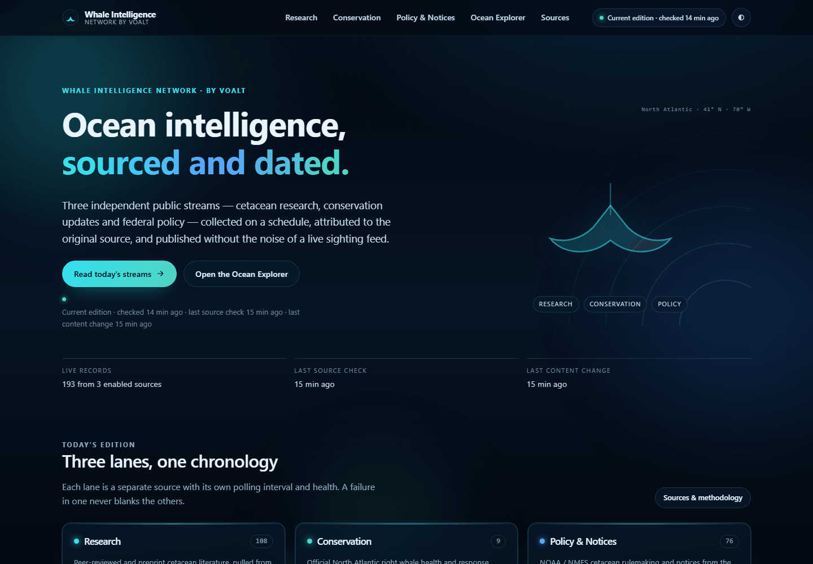
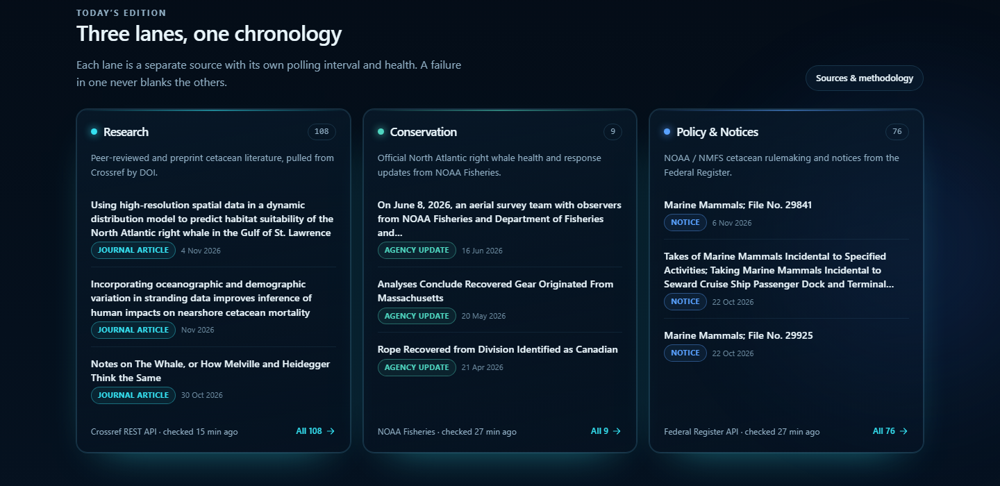
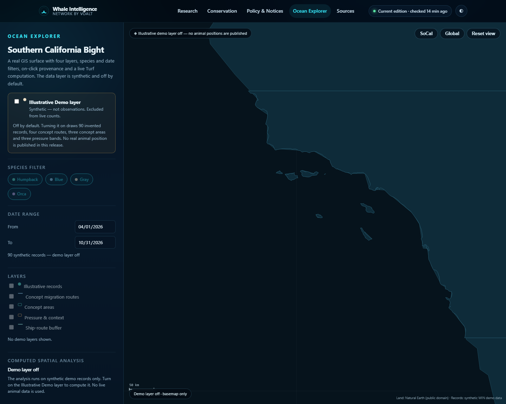
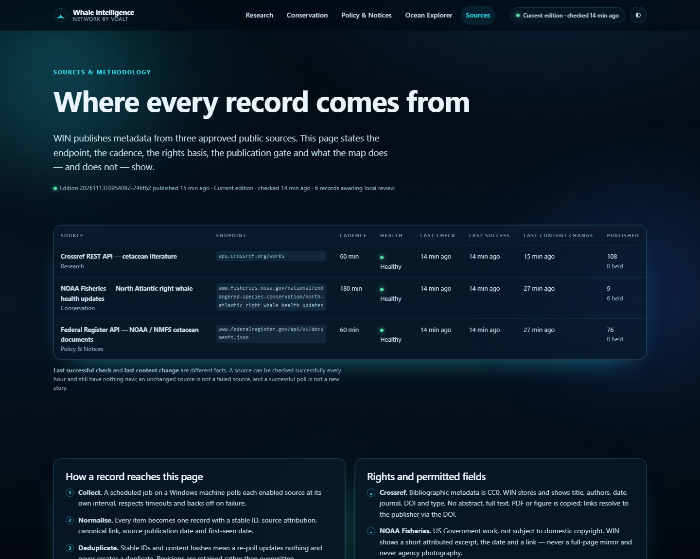
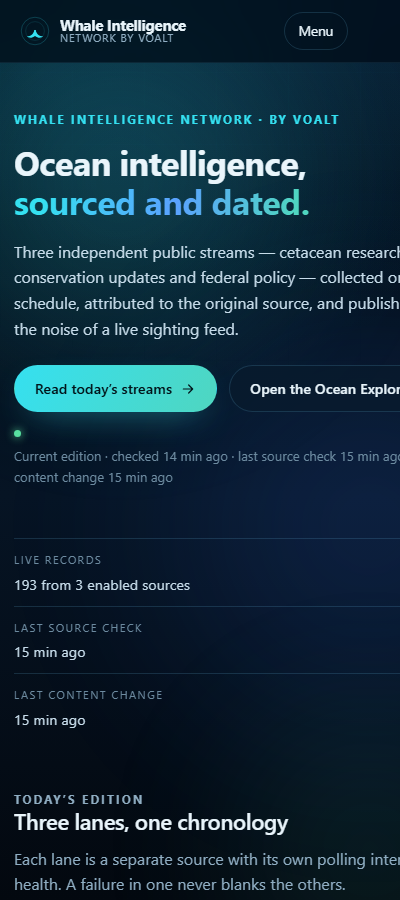

# Whale Intelligence Network

**Live:** <https://whale-intelligence-network.pages.dev>

A conservation and research platform for whales, dolphins and marine conservation,
built so that a claim can always be traced to the source behind it. This release
publishes three real, independent streams and a spatial explorer — every record
carries its publisher, a canonical link, the source's own publication date and the
date it was first seen.

This repository is a **public project showcase**. The implementation is developed
privately; no source code is published here.

---

## What this release actually does

| Lane | Source | What is shown |
|---|---|---|
| **Research** | Crossref REST API, narrow cetacean queries, DOI de-duplication | title, authors, publication date, journal, DOI, article type, publisher link. Preprints are labelled. No abstracts or full text. |
| **Conservation** | NOAA Fisheries North Atlantic right whale health updates | short attributed excerpts with the agency's date and a link to the official page. Anything that could reveal a recent or sensitive animal location is held for human review. |
| **Policy & Notices** | Federal Register API, NOAA/NMFS cetacean documents | agency, document type (proposed rule, final rule, notice), publication date, official abstract, official link, and a deadline only when the source supplies one. |

Each lane is an independent connector with its own polling interval, enable switch,
rights declaration and health status. A source that fails is marked failing and keeps
its previous successful check on display; the other two lanes continue, and the site
keeps serving the last complete edition with its age.

**Last successful source check** and **last content change** are reported separately.
An unchanged source is not a failed source, and a successful poll is not a new story.

## Ocean Explorer

The GIS explorer returns with species, date and layer filters, on-click provenance and
buffer analysis. Its data lives in a clearly labelled **Illustrative Demo** layer that
is off by default, excluded from every live record count, and marked synthetic wherever
it appears. This release publishes no animal positions, no tracks and no location-bearing
media.

## Where the data comes from

A Sources & Methodology page inside the site explains every
endpoint, how often it is checked, what fields are republished and what the map does and
does not show.

- **Safe metadata publishes automatically** from approved sources.
- **Uncertain, restricted or sensitive material is held** in a private review queue for
  the publication contact, and never enters a public payload.
- Records are de-duplicated by stable source IDs, corrections are retained as revisions,
  and no publication happens from a partial edition: a complete versioned snapshot is
  written before the pointer moves, and the previous good version is kept for rollback.

## Screenshots

| Sources & methodology | Mobile |
|---|---|
|  |  |

## Roadmap

| Stage | State |
|---|---|
| Three sourced streams, spatial explorer, public site | Shipped |
| Hourly unattended collection and versioned publishing | Running on a scheduled local collector |
| Durable object storage for published snapshots | Blocked on storage billing activation |
| Fourth connector (NOAA passive acoustics archive, metadata only) | Planned, pending a rights review |
| Individual-whale registry | Not cleared for public release; stays private |
| Formal organisational structure and name clearance | Not started |

## What is not established

- **Not an organisation.** No nonprofit status, no board, no formal structure.
- **Not a live sighting feed.** No animal positions, no tracks, no social accounts.
- No population estimates, trend claims or policy recommendations of the platform's own.
- No photographs, audio or footage from any source is mirrored.
- No independent scientific review of the platform or its content.

## Content rights

- Crossref metadata is CC0; article text and abstracts remain the publisher's copyright and are not copied.
- NOAA Fisheries material is a US Government work, republished as short attributed excerpts without implying endorsement.
- Federal Register documents are public domain; the official abstract is used.
- Every record links to the original publisher rather than reproducing it.
- The individual-whale registry is kept separate from observations and is not part of this release.

## Related projects

Other projects in this portfolio are listed on the
[profile](https://github.com/DanUrtnowski).

See [CHANGELOG.md](CHANGELOG.md) for the public milestone record.
